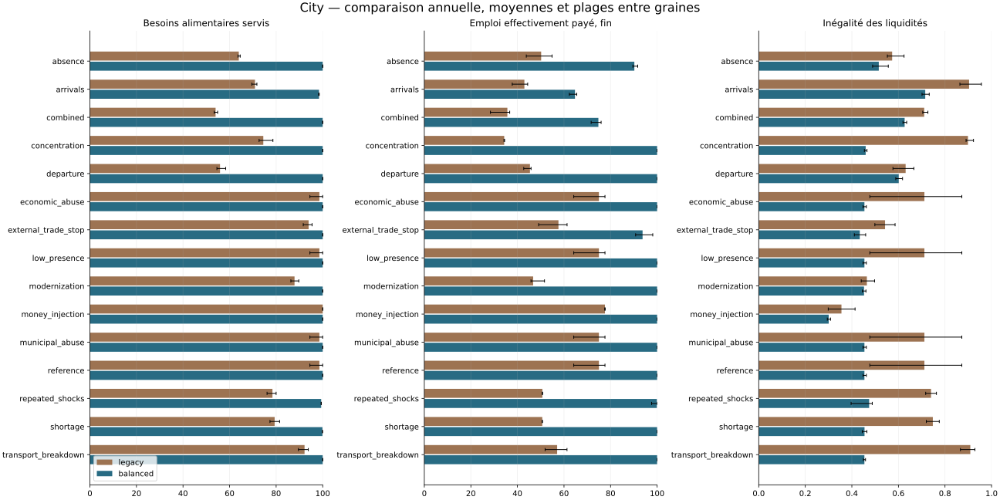
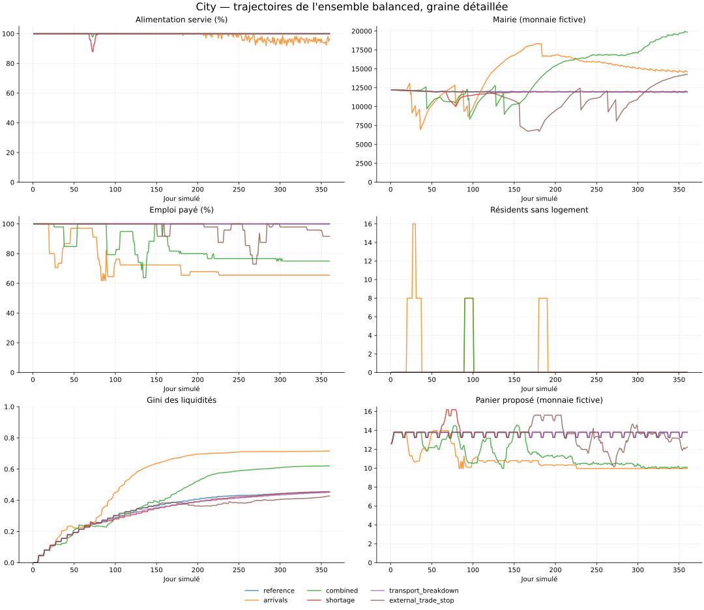

# City — simulation annuelle approfondie

360 jours, pas horaire, 15 scénarios, deux ensembles de règles et cinq comparaisons de mécanismes isolés sur la référence. **735 expériences**, **6,350,400 contrôles horaires**, graine détaillée 20261014 et 20 graines supplémentaires par cas.

La première simulation de 90 jours est conservée dans `results/first-simulation`. Ici, `legacy` reprend ses règles dans un monde enrichi par les saisons, les visiteurs, les achats d'aménagement et une stratégie opportuniste bornée. `balanced` teste des changements de règles sur le même modèle annuel. Comparer directement les chiffres v1 et v2 confondrait ces changements de périmètre.

## Résultat principal

Sur la graine détaillée, la référence `legacy` sert 99.40% des besoins et accumule 30 388.50 de salaires municipaux non versés. L'ensemble `balanced` sert 100.00%, avec 0.00 de salaires municipaux non versés, 11 912.72 en mairie, et un Gini des liquidités de 0.455.

Les résultats des arrivées et des crises doivent être évalués séparément : construire des logements et ouvrir des postes ne garantit ni la solvabilité des entreprises ni un revenu effectivement payé. Les critères chiffrés ci-dessous sont des hypothèses de cette expérience, pas des objectifs de jeu validés.

## Comparaison sur toutes les graines

Les valeurs indiquent moyenne et intervalle minimum–maximum. Les emplois sont mesurés en équivalents de journées effectivement rémunérées pendant les trente derniers jours, divisés par les résidents actifs. Le nombre de postes attribués est exporté séparément.

| Scénario | Nourriture legacy | Nourriture balanced | Emploi payé balanced | Sans logement balanced | Critères tous satisfaits balanced |
| --- | ---: | ---: | ---: | ---: | ---: |
| reference | 98.58% | 100.00% (100.00%–100.00%) | 100.0% | 0–0 | 21/21 |
| low_presence | 98.58% | 100.00% (100.00%–100.00%) | 100.0% | 0–0 | 21/21 |
| arrivals | 70.91% | 98.42% (98.23%–98.53%) | 64.7% | 0–0 | 0/21 |
| departure | 55.90% | 100.00% (100.00%–100.00%) | 100.0% | 0–0 | 10/21 |
| absence | 63.97% | 100.00% (99.99%–100.00%) | 90.2% | 0–0 | 21/21 |
| shortage | 79.36% | 99.89% (99.84%–99.93%) | 100.0% | 0–0 | 15/21 |
| concentration | 74.49% | 100.00% (100.00%–100.00%) | 100.0% | 0–0 | 21/21 |
| money_injection | 100.00% | 100.00% (100.00%–100.00%) | 100.0% | 0–0 | 21/21 |
| combined | 53.99% | 99.98% (99.97%–99.99%) | 74.8% | 0–0 | 0/21 |
| repeated_shocks | 78.41% | 99.34% (99.29%–99.43%) | 99.9% | 0–0 | 0/21 |
| transport_breakdown | 92.20% | 100.00% (100.00%–100.00%) | 100.0% | 0–0 | 21/21 |
| external_trade_stop | 93.95% | 100.00% (100.00%–100.00%) | 93.7% | 0–0 | 21/21 |
| modernization | 87.90% | 100.00% (100.00%–100.00%) | 100.0% | 0–0 | 21/21 |
| municipal_abuse | 98.58% | 100.00% (100.00%–100.00%) | 100.0% | 0–0 | 21/21 |
| economic_abuse | 98.58% | 100.00% (100.00%–100.00%) | 100.0% | 0–0 | 21/21 |



## Trajectoires dans l'année



## Ce qu'apportent les mécanismes isolés

Les cinq variantes n'activent qu'une famille de mécanismes. Leurs effets ne s'additionnent pas nécessairement ; les interactions sont testées par l'ensemble complet.

| Politique, référence | Nourriture moyenne | Emploi payé fin moyen | Mairie finale moyenne | Gini liquidités moyen |
| --- | ---: | ---: | ---: | ---: |
| legacy | 98.58% | 75.0% | 5.82 | 0.712 |
| balanced | 100.00% | 100.0% | 11 926.28 | 0.454 |
| storage_only | 100.00% | 100.0% | 29 137.61 | 0.383 |
| pricing_only | 100.00% | 86.8% | 4.40 | 0.514 |
| finance_only | 100.00% | 100.0% | 11 972.77 | 0.384 |
| growth_only | 100.00% | 86.8% | 5.93 | 0.322 |
| distribution_only | 96.66% | 69.5% | 5.87 | 0.662 |

- **Stockage :** réserve cible d'un jour, pertes municipales divisées par quatre, prestation de conservation payante à sept unités par jour. Si elle n'est pas intégralement payée, la conservation redevient ordinaire.
- **Prix publics :** coût de production et demande visible, stocks agrégés des vendeurs, marge cible de 8 %, variation journalière limitée à 5 % et borne de prix existante. Les coûts du travail et des intrants restent visibles ; la recette 1:1 est conservée.
- **Finances :** volume de contrats extérieurs adapté au déficit observé et à une cible de trésorerie, plafond d'achat extérieur, aide personnelle plafonnée à trente jours et budget municipal de secours. Une subvention ne crée pas de monnaie.
- **Croissance :** priorité aux matériaux des chantiers, financement préalable conservant une réserve salariale, chaînes alimentaires collectives avec capital réellement transféré, deux emplois publics supplémentaires par projet de logement. Les entreprises insolvables peuvent vendre leur stock et reprendre si leur trésorerie le permet.
- **Répartition :** partage hebdomadaire de 30 % du surplus disponible avec les salariés, dividende propriétaire plafonné à 50 % de ce surplus, réserve de travail maintenue, taxe hebdomadaire de 1 % des liquidités au-delà de 2 000 unités, au plus deux entreprises contrôlées initialement par un joueur. Ces réglages restent à comparer avec d'autres distributions.

## Incidents, causes et personnes touchées

**reference :** alimentation 100.00%, plus longue séquence sous 99 % : 0 jours ; emploi payé final 100.0%. Critères non satisfaits : aucun.

**low_presence :** alimentation 100.00%, plus longue séquence sous 99 % : 0 jours ; emploi payé final 100.0%. Critères non satisfaits : aucun.

**arrivals :** alimentation 98.47%, plus longue séquence sous 99 % : 92 jours ; emploi payé final 65.5%. 84 résidents, 4 projets de logements et 4 chaînes alimentaires ouverts ; 0 ménages restent sans logement. Arrêts faute de liquidités : bakery_a à J73 (38.16); vegetables_b à J78 (25.88); vegetables_a à J79 (68.65); grain_a à J81 (43.78); grain_b à J83 (31.38); bakery_b à J83 (36.38); mill à J106 (52.72); cooperative1_bread à J226 (0.00). Critères non satisfaits : food, food_gap, employment, inequality.

**departure :** alimentation 100.00%, plus longue séquence sous 99 % : 0 jours ; emploi payé final 100.0%. Récupérations après événement : absence fin J220 : 1 jours. Critères non satisfaits : inequality.

**absence :** alimentation 100.00%, plus longue séquence sous 99 % : 0 jours ; emploi payé final 91.7%. Arrêts faute de liquidités : grain_a à J106 (46.77); vegetables_b à J111 (65.58); bakery_b à J125 (67.73); grain_b à J169 (46.63); vegetables_a à J176 (73.64); mill à J180 (17.48); bakery_a à J180 (0.00); cooperative3_bread à J204 (9.73); cooperative4_bread à J215 (35.41); cooperative4_flour à J284 (6.47). Récupérations après événement : absence fin J140 : 1 jours. Critères non satisfaits : aucun.

**shortage :** alimentation 99.84%, plus longue séquence sous 99 % : 8 jours ; emploi payé final 100.0%. Récupérations après événement : shortage fin J79 : 1 jours. Critères non satisfaits : food_gap.

**concentration :** alimentation 100.00%, plus longue séquence sous 99 % : 0 jours ; emploi payé final 100.0%. Critères non satisfaits : aucun.

**money_injection :** alimentation 100.00%, plus longue séquence sous 99 % : 0 jours ; emploi payé final 100.0%. Critères non satisfaits : aucun.

**combined :** alimentation 99.99%, plus longue séquence sous 99 % : 2 jours ; emploi payé final 75.0%. 60 résidents, 1 projets de logements et 4 chaînes alimentaires ouverts ; 0 ménages restent sans logement. Arrêts faute de liquidités : bakery_b à J122 (63.05); vegetables_b à J124 (27.85); grain_a à J128 (39.88); mill à J132 (56.47); grain_b à J134 (41.15); vegetables_a à J157 (2.60); bakery_a à J164 (27.61); cooperative4_bread à J166 (21.25); cooperative4_flour à J178 (2.99); cooperative3_bread à J212 (37.23); cooperative3_flour à J296 (0.00). Récupérations après événement : absence fin J140 : 1 jours; shortage fin J79 : 1 jours. Critères non satisfaits : employment, inequality.

**repeated_shocks :** alimentation 99.37%, plus longue séquence sous 99 % : 9 jours ; emploi payé final 100.0%. Récupérations après événement : shortage fin J74 : 1 jours; shortage fin J134 : 1 jours; shortage fin J194 : 1 jours; shortage fin J254 : 2 jours; shortage fin J314 : 1 jours. Critères non satisfaits : food_gap.

**transport_breakdown :** alimentation 100.00%, plus longue séquence sous 99 % : 0 jours ; emploi payé final 100.0%. Récupérations après événement : transport fin J89 : 1 jours. Critères non satisfaits : aucun.

**external_trade_stop :** alimentation 100.00%, plus longue séquence sous 99 % : 0 jours ; emploi payé final 94.7%. Arrêts faute de liquidités : workshop à J151 (35.11); bakery_a à J208 (51.67); vegetables_b à J225 (69.07); bakery_b à J247 (62.57); mill à J255 (52.18); vegetables_a à J258 (38.92); grain_a à J264 (8.58); grain_b à J267 (17.75); cooperative3_bread à J287 (35.90); cooperative4_bread à J300 (24.62); cooperative4_flour à J333 (3.76). Récupérations après événement : external_stop fin J179 : 1 jours. Critères non satisfaits : aucun.

**modernization :** alimentation 100.00%, plus longue séquence sous 99 % : 0 jours ; emploi payé final 100.0%. Critères non satisfaits : aucun.

**municipal_abuse :** alimentation 100.00%, plus longue séquence sous 99 % : 0 jours ; emploi payé final 100.0%. 4 opérations abusives refusées avant mutation. Critères non satisfaits : aucun.

**economic_abuse :** alimentation 100.00%, plus longue séquence sous 99 % : 0 jours ; emploi payé final 100.0%. 3 opérations abusives refusées avant mutation. Critères non satisfaits : aucun.

## Arrivants et anciens, graine détaillée

Les cohortes ne sont pas agrégées en un seul joueur moyen. La part des dépenses essentielles dans le revenu est la médiane des rapports individuels ; elle peut dépasser 100 % quand la dotation initiale finance la consommation.

| Cohorte | Ménages | Liquidités médianes | Liquidités minimales | Portions manquantes cumulées | Sans logement |
| --- | ---: | ---: | ---: | ---: | ---: |
| PNJ initiaux | 40 | 1 464.29 | 0.00 | 244 | 0 |
| joueurs initiaux | 8 | 2 867.97 | 0.00 | 32 | 0 |
| arrivants J20 | 12 | 3.56 | 0.00 | 211 | 0 |
| arrivants J27 | 8 | 2.40 | 0.00 | 150 | 0 |
| arrivants J90 | 8 | 2.36 | 0.00 | 122 | 0 |
| arrivants J180 | 8 | 3.82 | 0.00 | 90 | 0 |

## Comptabilité, dépendance extérieure et critères

La référence `balanced` reçoit 45 301.27 nets de l'extérieur sur l'année. Son compte extérieur termine à 54 698.73 ; la monnaie initiale du monde inclut ce compte. Une ville stable grâce à ces échanges n'est pas autonome. Les visiteurs reçoivent un budget transféré, puis rendent les fonds inutilisés ; ni PNJ ni marché ne disposent d'un budget infini.

Critères provisoires : alimentation annuelle ≥99%, pas plus de 7 jours consécutifs sous 99 %, emploi payé final ≥80%, aucun ménage sans logement, aucun salaire municipal non payé, sept jours de réserve salariale municipale, Gini des liquidités ≤0.6. Le Gini élargi ajoute trésorerie et inventaire des entreprises détenues, valorisé aux prix de départ ; il ne valorise pas le foncier ni les bâtiments.

Les conservation monétaire et matière sont contrôlées à chaque heure. Les commandes répétés, réservations, bénéficiaires municipaux, budgets et conflits d'intérêt restent contrôlés avant application. Les arrondis du demi-salaire horaire ne sont pas assimilés à des impayés. Les variantes à journal réduit appliquent les mêmes règles ; leur égalité avec une exécution détaillée est testée.

## Limites du modèle

- Un ménage reste une personne. Les résidents actifs consomment deux portions par jour ; qualité artisanale, santé, vieillissement, familles et relations ne sont pas simulés.
- Les stratégies représentées sont simples : routines, propriété, budget d'aménagement, contribution du coopérateur et tentative de stockage/revente de l'opportuniste. Elles ne prédisent ni coalitions, ni décisions d'une communauté humaine.
- Les élus sont représentés par des approbations programmées, pas des élections. Les tentatives d'abus testent les règles locales ; elles ne constituent pas un audit de sécurité d'un serveur concurrent.
- La modernisation finance une capacité supplémentaire et conserve les emplois et recettes. Elle ne permet pas de conclure sur la disparition de l'artisanat. La crypto reste séparée et n'est pas incluse dans cette expérience.
- Les prix restent plafonnés, le marché expire ses ordres à chaque lot, et l'extérieur conserve une demande limitée. Un déficit durable peut venir de ces choix autant que d'une mauvaise capacité de production.
- Les aides et votes simulés sont visibles, mais une aide personnelle consommée n'est jamais revendable. En sommeil, ni salaire, dividende, partage de profit, aide ni loyer ; les logements sont protégés.
- Les mêmes graines appairent calendrier et météo. Les transactions et pertes peuvent diverger lorsque les règles changent ; les intervalles donnés sont des plages de simulation, pas des intervalles de confiance.

## Prochaine expérience utile

Revoir la viabilité des chaînes collectives et le financement du revenu des arrivants, puis comparer ces changements sur les mêmes graines. Ne pas valider un jeu sur la seule référence : utiliser les cohortes, les journées réellement payées, le temps de récupération et les budgets après crise.

## Reproduire et lire les exports

```bash
python3 -m citysim.annual --config config/extended.json --output results/annual-simulation --seeds 20 --workers 4
```

Chaque dossier `politique/scénario` contient configuration, expérience, séries quotidiennes et mensuelles, cohortes, profils, entreprises, visiteurs, événements, audit et empreintes. Les journaux monétaires, indicateurs horaires et trajectoires individuelles sont des CSV gzip (`*.csv.gz`). `runs.jsonl` contient toutes les graines ; `comparison.csv` et `paired_comparison.csv` comparent les résultats. `verification.json` documente les contrôles indépendants des exports. La vitesse d'exécution du programme ne modifie pas les délais d'absence exprimés en temps réel.

## Diagnostic financier des entreprises

Les paiements réellement exécutés depuis les comptes de réservation sont attribués à leur acheteur. La marge de trésorerie ci-dessous est la recette moins achats d'intrants, salaires, taxes, entretien, livraison et autres charges ordinaires, avant dividendes, partage de profits et investissement technologique. Les apports de capital sont séparés des recettes. Ce bilan utilise les achats de stocks, sans valoriser les variations d'inventaire : il ne constitue pas un compte de résultat comptable complet.

| Arrivées, balanced | Premier arrêt | Recettes des 30 jours précédents | Achats d'intrants | Salaires | Autres charges | Marge de trésorerie avant distributions |
| --- | ---: | ---: | ---: | ---: | ---: | ---: |
| grain_a | J81 | 371.60 | 0.00 | 1620.00 | 71.03 | -1319.43 |
| grain_b | J83 | 455.16 | 0.00 | 1620.00 | 73.47 | -1238.31 |
| mill | J106 | 954.98 | 441.32 | 1620.00 | 149.90 | -1256.24 |
| bakery_a | J73 | 2246.04 | 1433.53 | 2160.00 | 156.64 | -1504.13 |
| bakery_b | J83 | 2278.36 | 1531.31 | 2155.50 | 164.56 | -1573.01 |
| vegetables_a | J79 | 1396.28 | 0.00 | 2700.00 | 130.71 | -1434.43 |
| vegetables_b | J78 | 1372.08 | 0.00 | 2700.00 | 130.04 | -1457.96 |
| cooperative1_bread | J226 | 2390.52 | 1538.62 | 1068.75 | 121.78 | -338.63 |

8 des 8 entreprises qui s'arrêtent dans ce scénario ont une marge de trésorerie négative sur les trente jours précédents. L'ouverture de capacités collectives modifie la répartition des ventes et des coûts ; les effectifs et les plafonds de prix ne s'ajustent pas automatiquement à cette nouvelle concurrence. Les apports initiaux peuvent masquer ce déséquilibre pendant plusieurs semaines.

Les causes immédiates d'arrêt restent le financement insuffisant d'une journée de salaires et d'entretien. Ces bilans distinguent recettes, achats de stocks, distributions et investissement ; chaque solde final est vérifié contre les comptes exportés. Ils n'isolent pas à eux seuls l'effet causal d'un paramètre. Les comparaisons de règles et les trajectoires individuelles restent nécessaires.

Le fichier `financial_diagnostics.csv` contient aussi les marges mensuelles et annuelles de la référence, des arrivées, des absences et du scénario combiné. Les montants du tableau sont exprimés en monnaie fictive.
