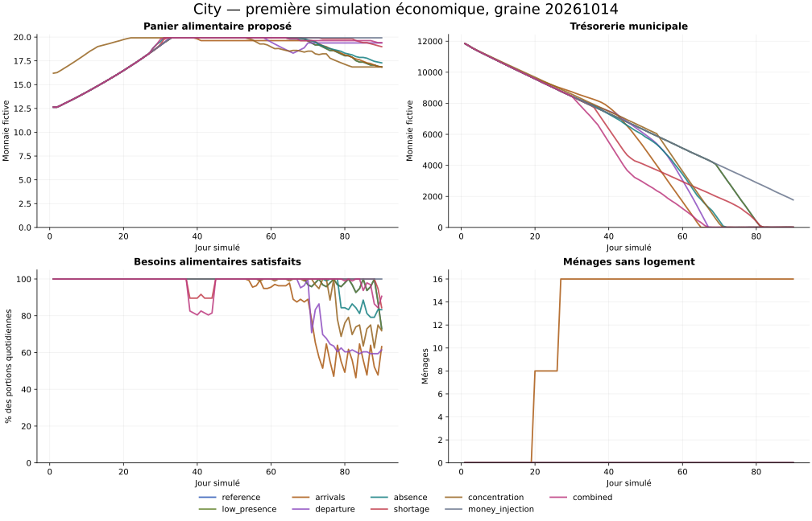

# Première simulation économique de City

Expérience locale du 14 octobre 2026. Tous les montants ci-dessous sont exprimés en unités de monnaie fictive (100 centimes = 1 unité).

9 scénarios, 90 jours par scénario, un pas d'une heure, graine détaillée **20261014**. 270 expériences supplémentaires de variabilité ; 3 variantes de réglage détaillées.

## Conclusion du premier passage

La référence sert **98.96%** des besoins alimentaires, avec **16 jours incomplets**. La trésorerie municipale passe de **12 000.00** à **4.31**, et le panier proposé de **12.64** à **16.86**.

Les **2160 contrôles horaires** de la référence ferment la comptabilité monétaire et matière. Cette exactitude ne suffit pas à valider les règles économiques : les réserves périssables coûtent cher à renouveler et le prix fondé sur le stock d'un seul vendeur peut monter même quand d'autres fournisseurs disposent de marchandises.

## Comparaison des scénarios

| Scénario | Alimentation servie | Jours incomplets | Panier final | Mairie finale | Sans logement (pic / fin) | Emploi final |
| --- | ---: | ---: | ---: | ---: | ---: | ---: |
| reference | 98.96% | 16 | 16.86 | 4.31 | 0 / 0 | 100.0% |
| low_presence | 98.96% | 16 | 16.86 | 4.31 | 0 / 0 | 100.0% |
| arrivals | 88.62% | 35 | 16.86 | 5.48 | 16 / 16 | 70.6% |
| departure | 91.74% | 22 | 19.38 | 6.21 | 0 / 0 | 93.8% |
| absence | 97.73% | 13 | 17.29 | 5.04 | 0 / 0 | 100.0% |
| shortage | 98.98% | 9 | 18.99 | 3.20 | 0 / 0 | 100.0% |
| concentration | 95.75% | 20 | 16.86 | 6.36 | 0 / 0 | 89.6% |
| money_injection | 100.00% | 0 | 19.92 | 1 771.64 | 0 / 0 | 100.0% |
| combined | 98.02% | 15 | 19.41 | 5.92 | 0 / 0 | 100.0% |



Le panier est la moyenne non pondérée des prix proposés par les entreprises en fonctionnement, pour un pain et un légume. Il exclut loyer et livraison. Les aides gratuites ne constituent pas un prix de marché. Le taux d'alimentation compte deux portions par ménage actif et par jour, aides et substitutions incluses.

## Variabilité

La graine détaillée n'est pas comptée dans les graines supplémentaires. Chaque intervalle ci-dessous indique minimum–maximum, sans interprétation comme intervalle de confiance.

| Scénario | Graines supplémentaires | Alimentation servie | Mairie finale | Jours incomplets |
| --- | ---: | ---: | ---: | ---: |
| reference | 30 | 98.80%–99.11% | 3.53–6.69 | 13.0–16.0 |
| low_presence | 30 | 98.80%–99.11% | 3.53–6.69 | 13.0–16.0 |
| arrivals | 30 | 88.26%–88.67% | 3.08–9.30 | 33.0–39.0 |
| departure | 30 | 90.96%–92.02% | 3.29–9.34 | 21.0–25.0 |
| absence | 30 | 97.55%–97.76% | 2.94–8.57 | 12.0–14.0 |
| shortage | 30 | 98.75%–99.06% | 3.61–9.27 | 8.0–11.0 |
| concentration | 30 | 95.57%–95.91% | 3.14–9.14 | 16.0–25.0 |
| money_injection | 30 | 100.00%–100.00% | 1 733.40–1 879.84 | 0.0–0.0 |
| combined | 30 | 97.48%–98.15% | 3.02–8.30 | 13.0–16.0 |

## Réglages comparés à la référence

Même graine et mêmes événements de référence ; les modifications sont des hypothèses, pas des décisions validées.

| Variante | Paramètres modifiés | Alimentation servie | Mairie finale | Panier final | Gini des liquidités |
| --- | --- | ---: | ---: | ---: | ---: |
| price_signal | price_scarcity_stock_ratio=0.25 | 99.31% | 4.00 | 17.06 | 0.947 |
| smaller_reserve | reserve_target_bread=48; reserve_target_vegetables=48 | 99.44% | 8 083.62 | 17.04 | 0.947 |
| price_and_reserve | price_scarcity_stock_ratio=0.25; reserve_target_bread=48; reserve_target_vegetables=48 | 99.65% | 8 264.22 | 17.17 | 0.951 |

Le seuil de prix plus bas teste une réaction moins sensible à l'épuisement du stock d'un vendeur. Les réserves plus petites réduisent les pertes et les achats de renouvellement, mais offrent moins de protection face à une pénurie. La variante combinée explore leur interaction ; elle ne démontre pas leur robustesse dans les autres scénarios.

## Incidents et contraintes observés

**Référence :** premier salaire non versé au jour 82, puis 476 échéances horaires non payées. Les contrats de services municipaux ne couvrent qu'une partie des salaires ; taxes et loyers complètent le financement, tandis que les achats de renouvellement des réserves épuisent la trésorerie.

**Faible présence :** les mouvements financiers sont identiques à la référence, car la présence connectée ne modifie pas les routines. Cette égalité vérifie une règle du modèle ; elle ne prédit pas les décisions d'un groupe humain peu actif.

**Arrivées :** 68 ménages pour 52 logements et 48 postes affectés. Aucun chantier ne termine. Le stock de matériaux reste entre 72 et 72 unités, sous le besoin de 120 unités par chantier : l'atelier produit 24 unités par jour et exporte jusqu'à 24 unités, empêchant l'accumulation pour construire. Le budget municipal se dégrade ensuite. L'expansion ne peut donc pas résoudre l'accueil avec cette priorité d'exportation.

**departure :** 6 ménages entrent en sommeil aux jours [43]. Les commerces de leurs propriétaires suspendent leur production et les emplois se redistribuent dans les capacités disponibles. Les protections suspendent revenus et loyers ensemble ; les salariés des entreprises fermées restent exposés au manque de postes.

**departure, jour 64 :** mill ne peut plus financer sa journée de travail (trésorerie 0.00). Le moteur suspend le travail faute de pouvoir financer salaire et entretien, sans effacer les biens ni créer de monnaie. Les stocks restants ne sont pas vendus en mode insolvable dans ce premier modèle ; une liquidation ou une recapitalisation reste à définir.

**absence :** 2 ménages entrent en sommeil aux jours [38]. Les commerces de leurs propriétaires suspendent leur production et les emplois se redistribuent dans les capacités disponibles. Les protections suspendent revenus et loyers ensemble ; les salariés des entreprises fermées restent exposés au manque de postes.

**Pénurie :** le minimum d'accès alimentaire pendant l'événement est 89.58%. Les réserves, achats extérieurs et substitutions amortissent la baisse agricole. Le bilan global doit être distingué de la réponse pendant l'événement : les difficultés tardives de trésorerie peuvent dominer ce bilan.

**concentration, jour 76 :** vegetables_a ne peut plus financer sa journée de travail (trésorerie 46.00). Le moteur suspend le travail faute de pouvoir financer salaire et entretien, sans effacer les biens ni créer de monnaie. Les stocks restants ne sont pas vendus en mode insolvable dans ce premier modèle ; une liquidation ou une recapitalisation reste à définir.

**Concentration :** l'opportuniste reçoit 21 100.27 de revenus nets (salaire et dividendes) et finit avec 19 448.73 en liquidités. La part maximale quotidienne des ventes essentielles d'un propriétaire atteint 100.0%. L'avantage observé dépend de la propriété et des prix initialement imposés ; aucun coût de rachat n'est modélisé.

**Injection :** 28 800.00 de monnaie sont émis et identifiés. Les ménages continuent à acheter seulement deux portions par jour ; la dotation évite leur manque de fonds, mais ne teste ni achats facultatifs, ni crédit, ni inflation immobilière.

**combined :** 2 ménages entrent en sommeil aux jours [38]. Les commerces de leurs propriétaires suspendent leur production et les emplois se redistribuent dans les capacités disponibles. Les protections suspendent revenus et loyers ensemble ; les salariés des entreprises fermées restent exposés au manque de postes.


## Budgets et causes à examiner

La référence engage **19 264.36** d'importations municipales sur 90 jours. Le solde net des échanges avec l'extérieur est **-1 444.36** reçu par l'économie locale (valeur négative : sortie nette). Les achats déjà payés et non encore livrés figurent dans `summary.json` et `audit.json`.

| Profil joueur, référence | Revenu net total | Dépenses essentielles | Solde final | Jours avec manque alimentaire |
| --- | ---: | ---: | ---: | ---: |
| salarié occasionnel | 1 426.23 | 1 725.09 | 1.14 | 2 |
| commerçant actif | 9 476.58 | 1 888.90 | 7 887.68 | 0 |
| artisan | 6 358.87 | 1 891.39 | 4 767.48 | 0 |
| nouvel arrivant | 1 355.85 | 1 655.85 | 0.00 | 0 |
| propriétaire | 2 283.79 | 1 886.45 | 697.34 | 0 |
| coopérateur | 2 782.74 | 1 887.61 | 1 195.13 | 0 |
| salarié régulier | 1 353.78 | 1 653.78 | 0.00 | 2 |
| opportuniste | 1 353.78 | 1 653.78 | 0.00 | 0 |

Les revenus nets comprennent salaires après taxe et dividendes. Le Gini mesure uniquement les liquidités des ménages ; il exclut la valeur des entreprises et du foncier. Le taux d'emploi mesure les postes affectés, et `profiles.csv` précise les jours de paiement ; un poste municipal peut être affecté sans salaire lorsque le budget est épuisé.

## Hypothèses et limites

- Un ménage représente un habitant, avec deux portions quotidiennes. Aucun décès, aucune dette automatique et aucun emprunt.
- Huit entreprises, une chaîne céréales → farine → pain, deux fournisseurs de légumes et un atelier de matériaux. Les recettes sont 1:1 ; les productions agricoles varient de ±10 % autour de leur capacité.
- Les 40 PNJ et les joueurs suivent des routines autorisées. La présence connectée ne procure aucun bonus. Les profils distinguent présence et propriété initiale ; artisanat de qualité, stratégie foncière et coopération sociale ne sont pas encore modélisés.
- Les salaires et loyers sont en centimes entiers. Les divisions horaires sont arrondies vers le bas. Les prix réagissent aux stocks et aux ventes observés ; la demande essentielle reste fixe, donc l'injection de monnaie ne suffit pas à tester une inflation générale.
- L'extérieur possède un budget fini : il achète des matériaux et des services municipaux, vend des vivres avec délai, et réalise les chantiers. Ce modèle teste une économie ouverte, pas une ville autonome.
- Les réserves municipales subissent la même conservation que les stocks privés. Les secours sont plafonnés et directement consommés, sans revente. Les imports restent limités et payés avant livraison.
- Une absence est mesurée en heures réelles indépendamment de la vitesse d'exécution du programme : réduction après 24 h réelles, sommeil après 72 h, à 6 heures simulées par heure réelle. Au sommeil, salaires, dividendes, besoins et loyers sont suspendus ; le logement reste occupé et protégé. La consommation suspendue est une convention abstraite d'absence.
- Les engagements municipaux exigent droit, absence de conflit et financement préalable. Les projets ont une approbation collective programmée ; élections, recours et votes humains ne sont pas simulés.
- Les arrivants reçoivent une émission explicite de monnaie. Une expansion exige un besoin de logement durable, un emploi affecté à au moins 55 % des actifs, matériaux et budget. L'activité sociale et le contenu d'une ville jouable restent à mesurer.
- La concentration est une différence de propriété et de politique tarifaire initiales, sans simuler un rachat. Modernisation, crypto, PNJ temporaires et vie personnelle détaillée sont différés.
- Les vérifications de commandes et de permissions sont locales. Elles ne démontrent pas la résistance d'un serveur concurrent ; cette étape demandera transactions atomiques et contrôle d'autorisation côté serveur.

## Suite proposée

Comparer les réglages de prix et de réserve sur les scénarios de pénurie et d'arrivée, financer durablement les emplois municipaux, et lier les nouvelles capacités d'emploi aux logements. Garder les exports de ce premier passage comme référence. Les objectifs chiffrés de récupération et d'installation restent à choisir avant de déclarer l'économie prête pour un prototype.

## Reproduction et fichiers

Depuis la racine du projet :

```bash
python3 -m citysim --config config/default.json --output results/first-simulation --seeds 30
```

`daily.csv` et `hourly.csv` contiennent les indicateurs ; la consommation n'est réglée qu'à l'heure 23, donc les valeurs alimentaires horaires avant cette clôture ne représentent pas un manque durable. `profiles.csv` et `businesses.csv` décrivent les trajectoires et soldes. `ledger.csv` enregistre les mouvements, `events.json` les causes, `audit.json` les conservations, et `manifest.json` les empreintes des exports. Les dossiers détaillés ne contiennent que la graine de référence ; les autres graines sont synthétisées dans `variability.csv`. `suite.json` rassemble le protocole et les contrôles.
