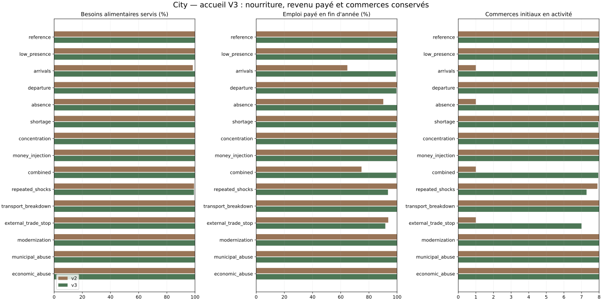
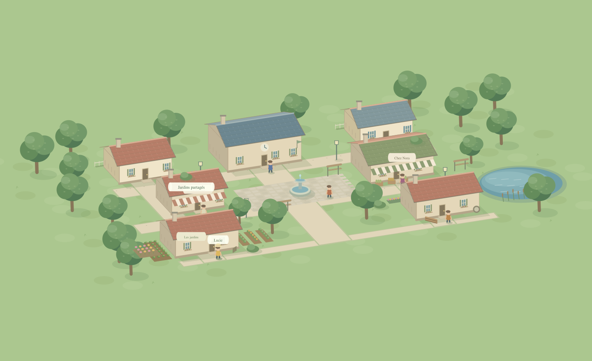

# City — accueil V3 et prototype simple

744 expériences, 6,946,560 contrôles horaires. Comparaison V2/V3 à monnaie initiale identique, puis quatre variantes isolant adaptation, tarifs, délégation et circulation. Horizon principal de 360 jours ; contrôle de durée sur 1080 jours.

Le témoin V2 exécute les règles annuelles antérieures ; un test compare ses comptes et séries à ceux du moteur initial. Les résultats historiques sont conservés. Ces comparaisons éprouvent des hypothèses ; elles ne valident ni le plaisir de jeu ni un serveur multijoueur.

## Accueil et résilience, toutes les graines

| Scénario | V2 emploi payé | V3 emploi payé | V3 alimentation | Commerces initiaux ouverts V3 | Critères V3 satisfaits |
| --- | ---: | ---: | ---: | ---: | ---: |
| reference | 100.0% | 100.0% | 100.00% | 8–8/8 | 21/21 |
| low_presence | 100.0% | 100.0% | 100.00% | 8–8/8 | 21/21 |
| arrivals | 64.7% | 99.2% | 100.00% | 7–8/8 | 19/21 |
| departure | 100.0% | 99.5% | 100.00% | 7–8/8 | 21/21 |
| absence | 90.2% | 100.0% | 100.00% | 8–8/8 | 21/21 |
| shortage | 100.0% | 99.5% | 99.88% | 7–8/8 | 15/21 |
| concentration | 100.0% | 100.0% | 100.00% | 8–8/8 | 21/21 |
| money_injection | 100.0% | 100.0% | 100.00% | 8–8/8 | 21/21 |
| combined | 74.8% | 99.5% | 99.97% | 7–8/8 | 20/21 |
| repeated_shocks | 99.9% | 93.6% | 99.26% | 7–8/8 | 0/21 |
| transport_breakdown | 100.0% | 100.0% | 100.00% | 8–8/8 | 21/21 |
| external_trade_stop | 93.7% | 91.7% | 100.00% | 7–7/8 | 21/21 |
| modernization | 100.0% | 100.0% | 100.00% | 8–8/8 | 21/21 |
| municipal_abuse | 100.0% | 100.0% | 100.00% | 8–8/8 | 21/21 |
| economic_abuse | 100.0% | 100.0% | 100.00% | 8–8/8 | 21/21 |



## Effet des mécanismes sur la référence

| Politique | Alimentation | Emploi payé | Gini liquidités | Critères |
| --- | ---: | ---: | ---: | ---: |
| v2 | 100.00% | 100.0% | 0.454 | 21/21 |
| v3 | 100.00% | 100.0% | 0.210 | 21/21 |
| adaptive_only | 100.00% | 100.0% | 0.461 | 21/21 |
| prices_only | 100.00% | 100.0% | 0.277 | 21/21 |
| delegation_only | 100.00% | 100.0% | 0.454 | 21/21 |
| circulation_only | 100.00% | 100.0% | 0.381 | 21/21 |

## Trois années simulées

| Scénario | Politique | Alimentation | Emploi payé fin | Fonds extérieurs finaux | Critères |
| --- | --- | ---: | ---: | ---: | ---: |
| reference | v2 | 100.00% | 96.8% | 439.56 | 5/5 |
| reference | v3 | 100.00% | 100.0% | 20368.70 | 5/5 |
| arrivals | v2 | 93.32% | 53.1% | 379.45 | 0/5 |
| arrivals | v3 | 100.00% | 96.3% | 7050.01 | 3/5 |
| combined | v2 | 99.99% | 71.5% | 177.15 | 0/5 |
| combined | v3 | 99.99% | 100.0% | 20391.02 | 5/5 |

Le budget extérieur reste fini et aucun financement implicite n'est ajouté. Les aides, investissements et prélèvements sont des transferts ; seules les dotations des arrivants et injections programmées créent de la monnaie. Le niveau de fonds extérieurs et les réserves des ménages sont à suivre au-delà de l'année favorable.

## Nouveaux habitants, graine détaillée

| Arrivée | Ménages | Premier salaire, attente maximale | Logement, attente maximale | Réserve médiane fin | Revenu net / dépenses essentielles fin |
| --- | ---: | ---: | ---: | ---: | ---: |
| J20 | 12 | 0 jours | 12 jours | 44.1 jours | 1.06 |
| J27 | 8 | 0 jours | 12 jours | 43.0 jours | 1.06 |
| J90 | 8 | 0 jours | 11 jours | 40.1 jours | 1.07 |
| J180 | 8 | 0 jours | 11 jours | 35.5 jours | 1.08 |

## Règles proposées et limites

- **Croissance progressive :** un poste financé à la fois dans les commerces existants, effectifs et capacité proportionnés à la population active. Les postes municipaux complètent l'accueil. Le dispositif conserve huit commerces au lieu d'ouvrir systématiquement des chaînes concurrentes.
- **Tarifs coopératifs :** prix communs par produit, calculés depuis coûts, intrants, pertes et marge cible de 2 %. Ils restent bornés et évoluent progressivement. Les commandes, budgets, stocks et livraisons déterminent encore les ventes ; aucun débouché artificiel n'est créé.
- **Délégation consentie dans le modèle :** les commerces alimentaires essentiels restent exploités avec une charge de gestion lorsque leur propriétaire s'absente. Le propriétaire en sommeil ne reçoit ni salaire, ni dividende, ni aide. En jeu, la routine sera annoncée et autorisée lors de l'installation du commerce.
- **Circulation :** prélèvement hebdomadaire de 25 % du surplus d'entreprise restant après distribution et réserve de travail ; prélèvement de 2 % des liquidités au-delà de 500 pièces. Ces seuils sont des hypothèses et restent à discuter ; ils déplacent les fonds vers les services publics sans les détruire.
- **Matériaux :** une réserve locale de 24 unités est prioritaire sur les exports pour permettre les aménagements. Les coûts de construction et de personnel restent financés avant application.

Les critères nouveaux distinguent une marge initiale d'au moins 5 % pendant le premier mois et, ensuite, un revenu après prélèvements couvrant les dépenses essentielles, avec au moins trois jours de réserve médiane. Ils ajoutent premier salaire sous trois jours, logement sous quatorze jours, accès alimentaire individuel des arrivants à 99 % et maintien d'au moins six commerces initiaux. Les seuils sont provisoires et ne remplacent pas les budgets les plus défavorables.

Les ménages, métiers et préférences restent simplifiés. Les tarifs coopératifs limitent la liberté commerciale de cette expérience. Les emplois municipaux représentent des services agrégés et les contrats extérieurs demeurent programmés. Un résultat satisfaisant dans ce cadre ne prouve pas un équilibre avec des comportements humains ou une demande extérieure différente.

## Gameplay simple et prototype

Deux choix obligatoires : logement et activité. Travail, courses et loyer suivent une routine ; aucun ordre de marché ou réglage fiscal n'est demandé au joueur. Jardin et banc sont des objectifs facultatifs. La carte permet déplacements au clic, flèches et ZQSD. Le carnet expose portefeuille, budget prévu et bilan groupé de la journée.

Le prototype utilise réellement la V3 et des transactions enregistrées dans SQLite, rejouées au redémarrage. Les actions répétées ne sont pas exécutées deux fois. La carte publique n'expose pas les budgets des autres habitants. Le personnage local est préapprouvé ; une véritable whitelist multijoueur reste une étape distincte.

Les journées n'avancent que dans un onglet actif, avec pause et avance manuelle. Hors connexion, aucune journée ni charge n'est ajoutée au prototype. Ce tempo d'essai ne représente pas encore le serveur persistant de la ville communautaire.

La restriction de l'environnement empêche l'ouverture de ports TCP et le lancement de Chromium. Le parcours a été exécuté avec le vrai script d'interface, un DOM de test, le vrai gestionnaire HTTP, le modèle Python et SQLite. La vérification visuelle de la mise en page dans un navigateur reste à faire sur la machine qui lance le jeu. L'aperçu de carte est rendu à partir des opérations du canvas ; ce n'est pas une capture d'écran du navigateur.



## Reproduire

```bash
python3 -m citysim.welcoming --config config/v3.json --output results/v3-simulation --seeds 20 --workers 4
```

```bash
python3 -m citygame --port 8092
```

Ouvrir `http://127.0.0.1:8092` sur la machine qui exécute la commande. Les sauvegardes locales sont dans `data/prototype.sqlite`, les tests de parcours dans `results/prototype`. Les calculs annuels et de longue durée sont exportés dans des dossiers distincts `annual` et `long`, avec journaux complets compressés pour la graine de référence.
